# Clinic CRM

A web-based clinic management and patient-relationship system for a **multi-specialty clinic**, built with plain PHP 8 (MVC-style, no framework), MySQL/MariaDB, HTML/CSS/JavaScript and Chart.js.

It connects one real workflow end to end:

**patient → appointment (or walk-in) → queue → consultation → prescription / follow-up → invoice → payments → reports**

> Version **1.0.0** · University BSCS project and portfolio demonstration · designed for one clinic, structured so it can grow to several.
> **Status:** feature-complete for the documented MVP; 136 automated tests pass (see [Testing status](#testing-status-honest-summary)). Not yet run on Windows/XAMPP — see [Known limitations](#known-limitations).

---

## Screenshots

All screenshots show the fictional demo data (`php bin/install-db.php --seed`).

| | |
|---|---|
| 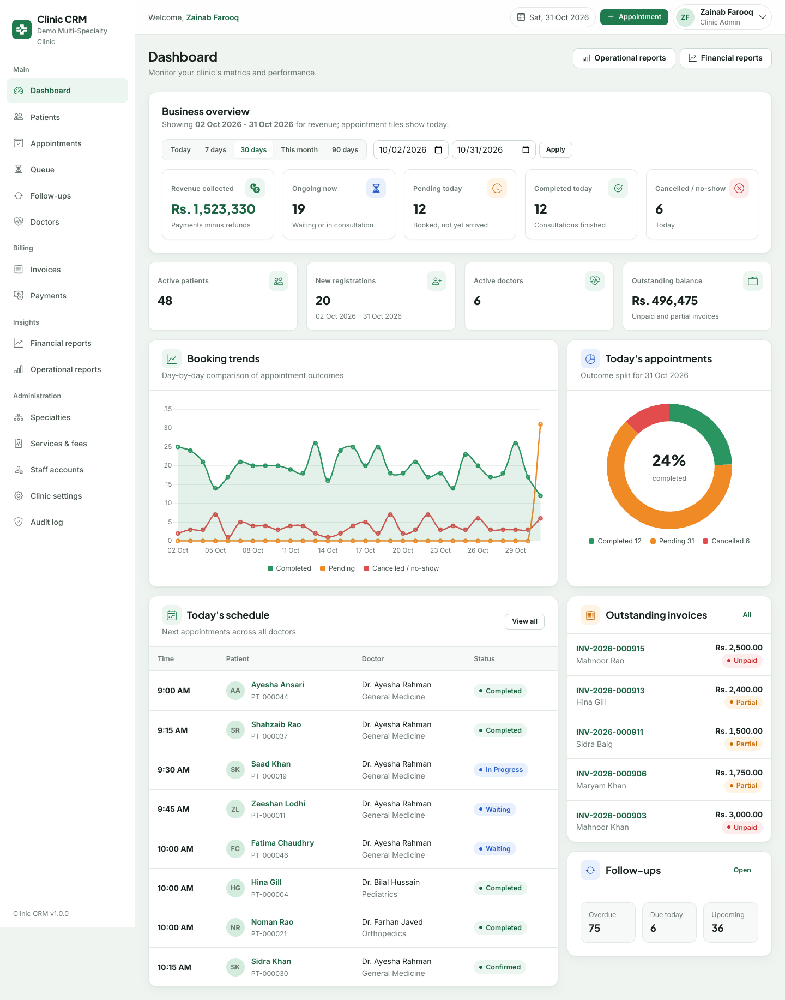<br>**Admin dashboard** — business overview, booking trends, today's outcomes | 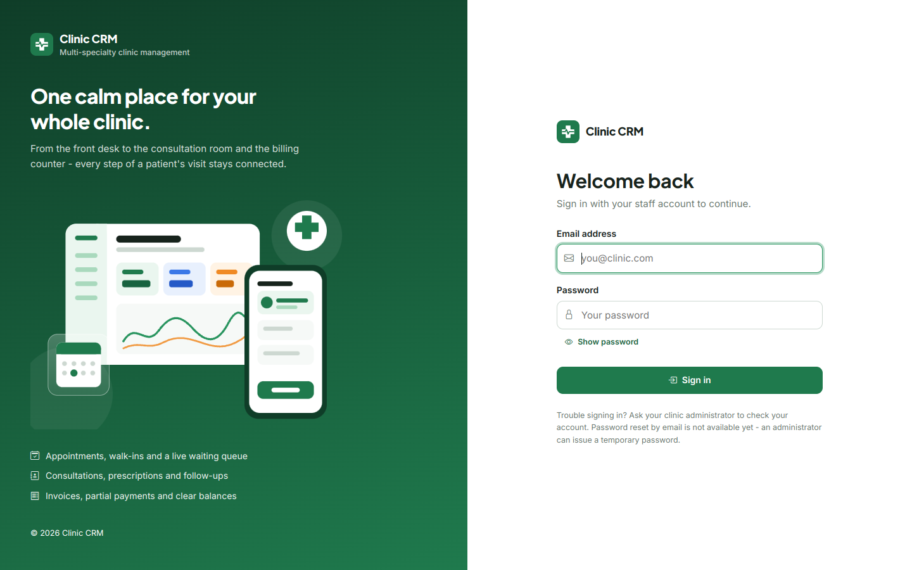<br>**Sign-in** |
| 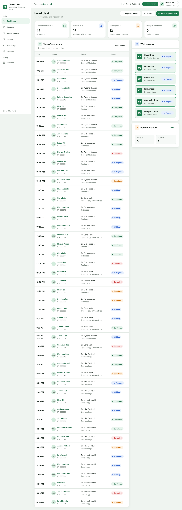<br>**Front desk dashboard** | 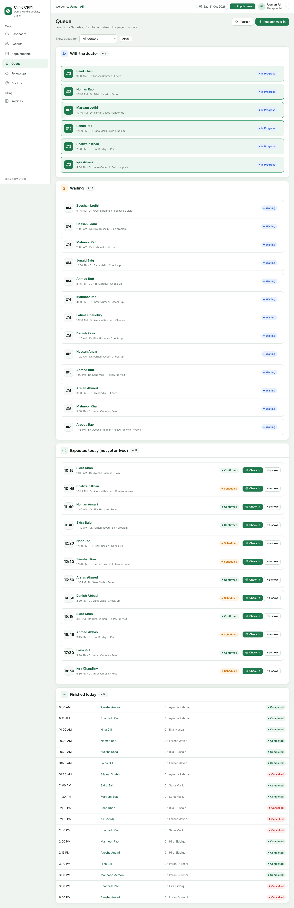<br>**Live queue** (check-in, walk-ins, start consultation) |
| 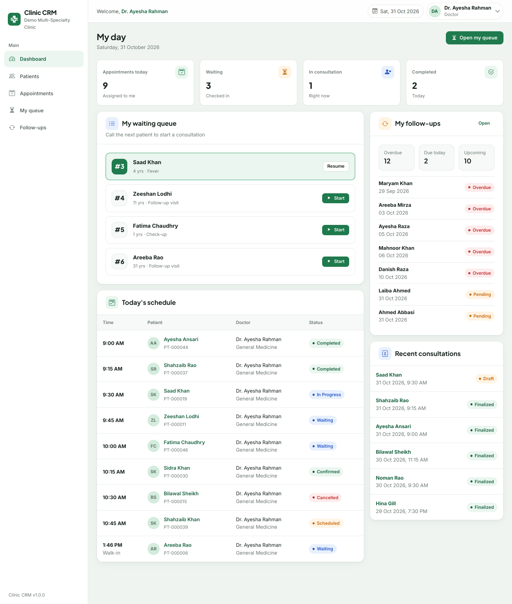<br>**Doctor dashboard** | 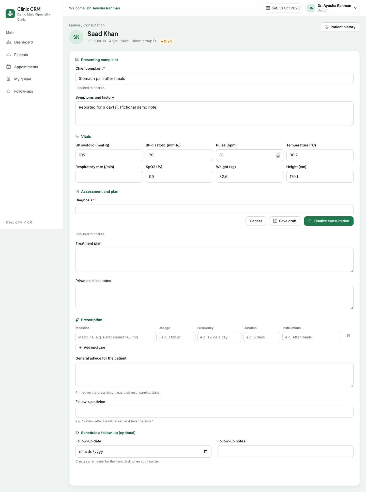<br>**Consultation** with vitals and prescription |
| 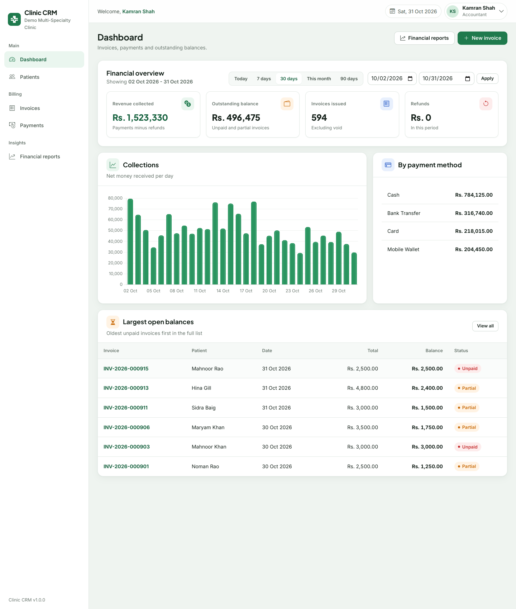<br>**Accountant dashboard** | 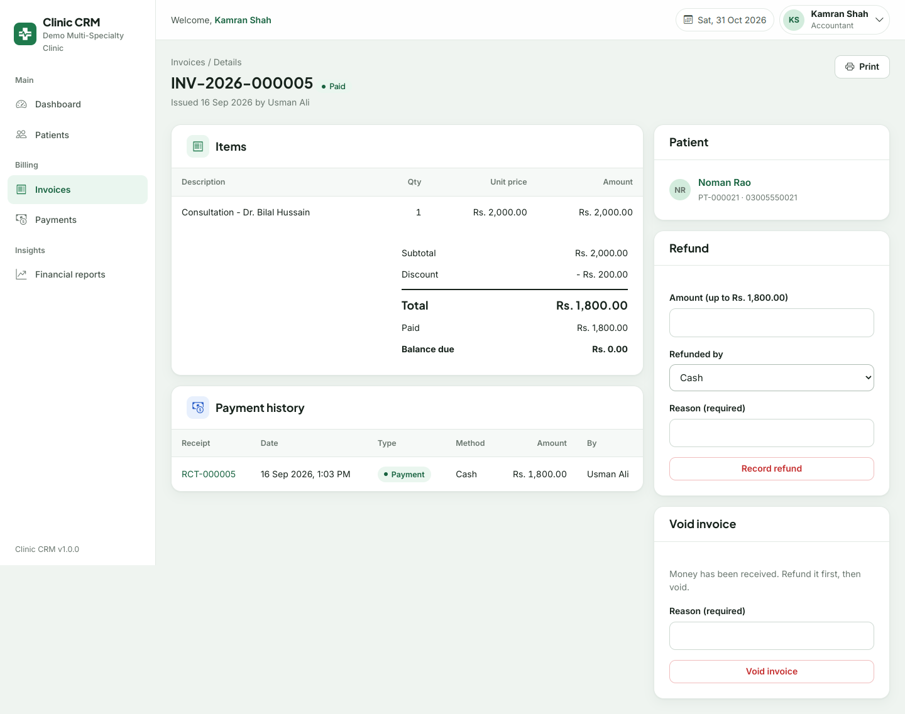<br>**Invoice** with payment history and actions |
| 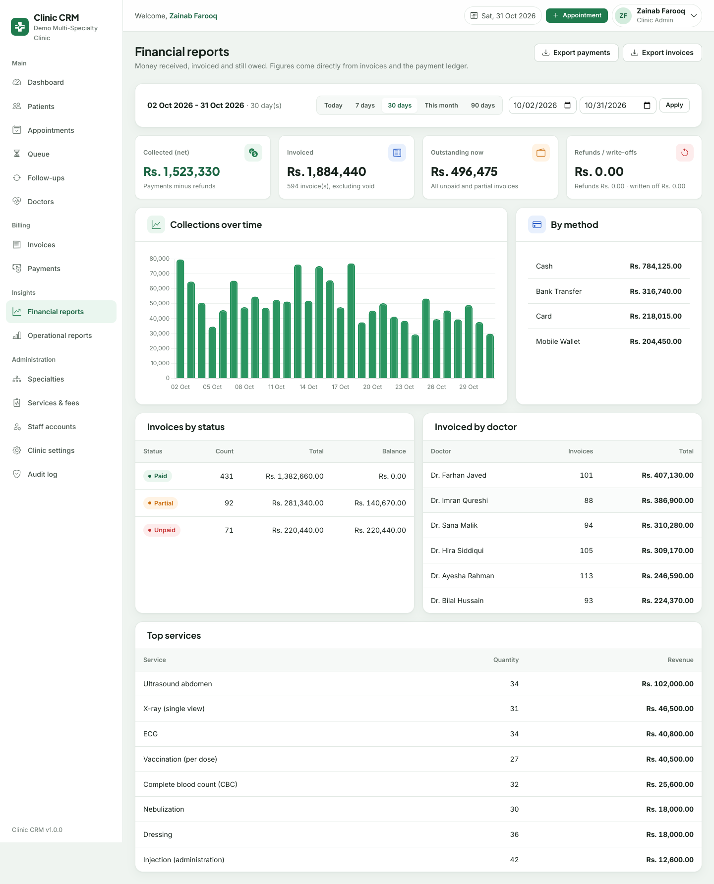<br>**Financial report** | 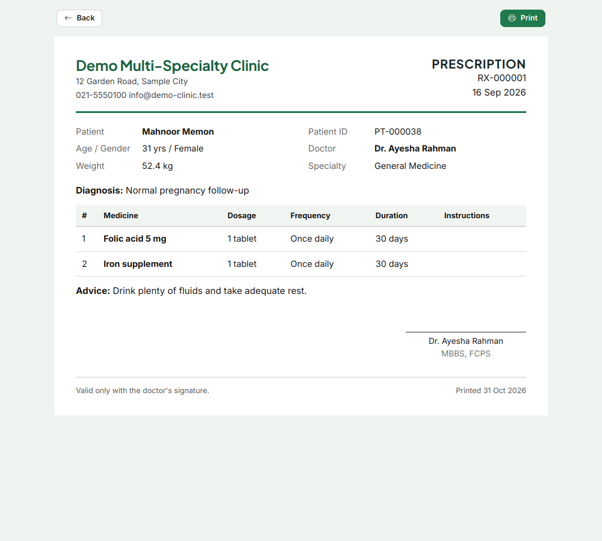<br>**Printable prescription** |
| 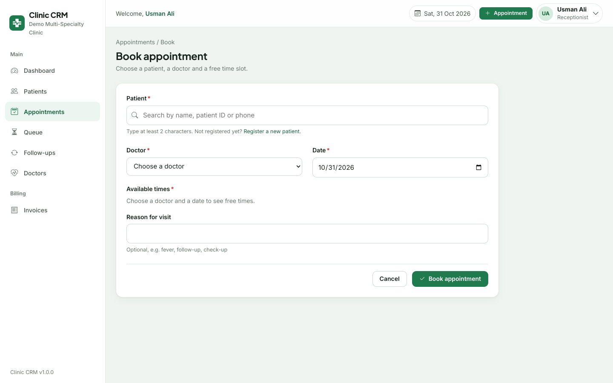<br>**Booking** with live free-slot picker | 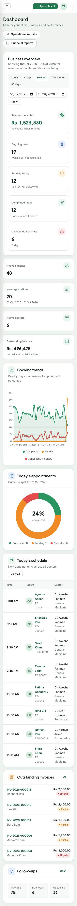<br>**Mobile layout** |

More: [patients](docs/screenshots/patients.png) · [visit record](docs/screenshots/visit-record.png) · [invoice print](docs/screenshots/invoice-print.png) · [audit log](docs/screenshots/audit-log.png)

---

## Key features

| Area | What it does |
|---|---|
| **Accounts & security** | One staff login that routes each role to its own dashboard. `password_hash()`, session-ID regeneration, CSRF tokens, login throttling, forced password change for temporary passwords, immediate effect when an account is deactivated. |
| **Roles (RBAC)** | Clinic Admin, Doctor, Receptionist, Accountant (Patient is reserved for a future portal). Permissions live in database tables and are enforced on the server for every route. |
| **Patients** | Register, search (name / ID / phone), edit, archive/restore, duplicate prevention, human-readable IDs (`PT-000123`), CSV export. |
| **Doctors & specialties** | Profiles linked to a login account, consultation fee, visit length, weekly working windows with overlap checks. |
| **Appointments** | Free-slot picker, double-booking protection (service rule **and** database unique key), reschedule, cancel with reason, walk-ins, status workflow with validated transitions. |
| **Queue** | Check-in with per-doctor queue numbers, live board for doctors and front desk. |
| **Consultations** | Complaint, vitals (range-checked), diagnosis, plan, multi-line prescription, draft → finalize, **amendments keep the previous version, who and why**. |
| **Prescriptions** | Print-friendly layout. (The system does not give medical advice or check drug safety.) |
| **Follow-ups** | Overdue / due today / upcoming / completed, created from a consultation or on their own. Reminders are tracked on screen only — nothing is sent. |
| **Billing** | Consultation fees + clinic services, discount, optional tax, partial and multiple payments, refunds, write-offs, voids, printable invoice and receipt. Integer minor-unit arithmetic, `DECIMAL` storage, append-only payment ledger. |
| **Dashboards & reports** | Role-specific dashboards, date ranges, Chart.js charts with empty states; financial and operational reports computed from stored records. |
| **Audit & exports** | Append-only audit log (database triggers block edits/deletes); CSV exports with spreadsheet-formula protection. |
| **Operations** | Backup and restore scripts, repeatable install script, demo seeder. |

## Roles at a glance

| Role | Main purpose | Cannot |
|---|---|---|
| **Clinic Admin** | Staff, doctors, services, settings, oversight, audit | Read clinical records, record/refund payments |
| **Doctor** | Own queue and appointments, consultations, prescriptions, follow-ups | See other doctors' patients, touch billing or administration |
| **Receptionist** | Registration, booking, walk-ins, queue, create invoices, take payments | See clinical records, refund, void, view reports |
| **Accountant** | Invoices, payments, refunds, adjustments, financial reports | See medical history or scheduling |

Full matrix: [docs/security.md](docs/security.md#role-permission-matrix).

---

## Technology stack

* **PHP 8.1+** (developed and tested on 8.3) with `pdo_mysql`, `mbstring` — no framework, no Composer packages required.
* **MySQL 5.7+/8 or MariaDB 10.4+** (tested on MariaDB 10.11).
* **Front end:** hand-written CSS design system (tokens taken from the supplied dashboard reference), vanilla JavaScript, **Chart.js 4**, **Bootstrap Icons**, **Inter** and **Plus Jakarta Sans** fonts — all vendored under `public/assets/vendor`, so the app works offline (e.g. on XAMPP without internet).
* Bootstrap CSS was deliberately *not* used: the supplied design tokens are small and a purpose-built stylesheet is lighter and easier to explain.

## Architecture summary

```
Browser → public/index.php (front controller)
        → Router → Middleware (signed in? → CSRF → permission)
        → Controller (thin) → Service (business rules, transactions) → Model (PDO queries)
        → View (PHP template, escaped output) → Response
```

Details, trade-offs and the transaction map: [docs/architecture.md](docs/architecture.md).

---

## Quick start

**Prerequisites:** PHP 8.1+ (with `pdo_mysql`, `mbstring`), MySQL or MariaDB running, a terminal. Windows/XAMPP users: follow the step-by-step guide in [docs/setup.md](docs/setup.md) (including the safe virtual-host setup).

```bash
# 1. configuration (PHP does NOT read .env by itself - the app does)
cp .env.example .env          # then edit DB_USER / DB_PASS if needed

# 2. database: creates `clinic_crm`, imports database/schema.sql, loads fictional demo data
php bin/install-db.php --seed

# 3. run (development server; the web root is public/ only)
php -S localhost:8000 -t public public/router.php
```

Open <http://localhost:8000> and sign in.

### Demo accounts (development only)

All demo accounts share the password **`ChangeMe!2026`** and **must change it at first sign-in**.

| Role | Email |
|---|---|
| Clinic Admin | `admin@demo-clinic.test` |
| Receptionist | `reception@demo-clinic.test` |
| Accountant | `accounts@demo-clinic.test` |
| Doctor | `ayesha@demo-clinic.test` (also `bilal@`, `sana@`, `imran@`, `hira@`, `farhan@demo-clinic.test`) |

**Never load demo data into a real installation.** For a real clinic use `php bin/install-db.php` (no `--seed`) and `php bin/create-admin.php "Full Name" you@clinic.com`. There is no default admin password.

### Running the tests

```bash
php tests/run.php                  # everything: unit + integration + HTTP end-to-end
php tests/run.php --unit           # no database needed
php tests/lint.php                 # syntax + unescaped-output check on every PHP file
node tests/browser/ui-checks.js http://localhost:8000   # layout / accessibility (needs Node + puppeteer)
```

The integration and HTTP tests use a **separate database** (`DB_TEST_NAME`, default `clinic_crm_test`) that is dropped and recreated on every run; the runner refuses to start if it equals `DB_NAME`. See [docs/testing.md](docs/testing.md) and the full [test report](docs/test-report.md).

### Backup and restore

```bash
php bin/backup.php                                      # -> storage/backups/clinic_crm-<timestamp>.sql
php bin/restore.php storage/backups/<file>.sql --db=clinic_crm_copy
```

Backups contain patient data — keep them private. Details in [docs/setup.md](docs/setup.md#backup-and-restore).

---

## Project structure

```
Clinic CRM/
├── app/
│   ├── Config/        role / permission / status / billing constants (no magic strings)
│   ├── Core/          router, request/response, session, CSRF, auth, validator, money, database, error handling
│   ├── Controllers/   thin: read input -> call a service -> return a response
│   ├── Services/      business rules and transactions (scheduling, visits, billing, reports ...)
│   ├── Models/        PDO queries, one class per table group
│   ├── Middleware/    AuthMiddleware, CsrfMiddleware, PermissionMiddleware
│   ├── Helpers/       view helpers (escaping, money/date formatting, form fields)
│   └── Views/         PHP templates (layouts, partials, one folder per module)
├── bin/               install-db, create-admin, backup, restore (command-line tools)
├── bootstrap/         autoloader, .env loader, error handler registration
├── config/            app, database, security settings (read from .env)
├── database/          schema.sql (tables, triggers, reference data), seed.php (fictional demo data), migrations/
├── docs/              all documentation + screenshots
├── public/            the ONLY web-accessible folder: index.php, router.php, .htaccess, assets/
├── routes/web.php     the route table: URL -> controller -> permission
├── storage/           logs/ and backups/ (git-ignored contents)
├── tests/             Unit/, Integration/, Http/, browser/, Support/, run.php, lint.php
├── .env.example · .gitignore · composer.json · prompt.md · README.md
```

Deviations from the suggested layout (and why) are listed in [docs/architecture.md](docs/architecture.md#deviations-from-the-suggested-structure).

---

## Security and privacy notes

* Server-side authorization on every route; **deny by default** (a route without an access rule is refused). Record ownership is enforced too: doctors see only their own queue and patients they have a care relationship with.
* PDO prepared statements everywhere; all output escaped; CSRF token on every POST; strict session cookies (`HttpOnly`, `SameSite=Lax`, `Secure` on HTTPS); Content-Security-Policy without inline scripts.
* Login throttling per email + IP (an attacker cannot lock a real user out from another address); generic error messages; timing-equalised password check.
* Payments, audit entries and visit amendments are **append-only at the database level**; invoices and finalized visits cannot be deleted.
* Only necessary patient data is stored; clinical content is visible to doctors only; every clinical record view is audited; passwords/tokens are never logged.
* All demo data is fictional. **No secrets are committed** — `.env` is git-ignored.

Full analysis, residual risks and a production hardening checklist: [docs/security.md](docs/security.md).

---

## Known limitations

These are real gaps, not marketing footnotes:

1. **Not tested on Windows/XAMPP/Apache.** Everything was run on Linux with PHP 8.3.6, MariaDB 10.11 and the PHP built-in server. The `.htaccess` rewrite rules and the XAMPP steps in `docs/setup.md` are written carefully but **unverified**. PHP 8.1/8.2 and MySQL 5.7/8 are likewise untested.
2. **No password reset by email** (no mail server is assumed). An admin issues a temporary password instead.
3. **No SMS / WhatsApp / email notifications.** Follow-ups are on-screen reminders only.
4. **Single clinic.** The schema has a `clinics` table and `clinic_id` columns, but queries are not yet scoped by clinic — see the roadmap.
5. **No patient portal** (by design for the MVP; `patients.user_id` is reserved).
6. Invoices cannot be edited after creation — void and re-issue. Discounts are a flat amount; the tax rate is one clinic-wide setting.
7. Idle-session expiry is implemented but **not covered by an automated test** (needs a 30-minute wait or a clock); verify manually with `SESSION_IDLE_MINUTES=1`.
8. Print views are verified as HTML only; no PDF/printer output was inspected. Accessibility was checked with automated rules and keyboard basics, **not** with a screen reader or formal audit.
9. The login reference image was not supplied, so the login page is derived from the supplied dashboard design (see [docs/requirements.md](docs/requirements.md#assumptions)).
10. Sessions use PHP's default file storage — fine for one server; a multi-server deployment needs shared session storage.
11. **Booking needs JavaScript** (the free-time picker is rendered by `app.js`); other core pages work without it.

## Roadmap

See [docs/roadmap.md](docs/roadmap.md): patient portal, password reset and notifications, multi-clinic scoping, appointment calendar view, lab/imaging orders, inventory, PDF output, two-factor authentication.

---

## Testing status (honest summary)

| Layer | Tests | Result |
|---|---|---|
| Unit (money, validation, status rules, CSV safety, date ranges, password policy) | 24 | ✅ pass |
| Integration against a real database (schema, permissions matrix, patients, scheduling, consultations, billing, dashboards, auth, seed integrity, backup/restore) | 82 | ✅ pass |
| HTTP end-to-end (login, CSRF, RBAC, XSS, SQL injection, full clinic journey, concurrency, links/forms/assets, DB outage) | 32 | ✅ pass |
| Static lint (157 PHP files) | — | ✅ pass |
| Browser UI checks (31 page visits × 3 widths, 4 roles) | — | ✅ pass |

Environment: PHP 8.3.6, MariaDB 10.11.14, Linux. Defects found and fixed during testing are listed in [docs/test-report.md](docs/test-report.md). **Passing tests do not prove the absence of bugs.**

## Documentation index

[requirements](docs/requirements.md) · [architecture](docs/architecture.md) · [workflow](docs/workflow.md) · [database](docs/database.md) · [security](docs/security.md) · [setup](docs/setup.md) · [testing](docs/testing.md) · [test report](docs/test-report.md) · [manual QA checklist](docs/manual-qa.md) · [user manual](docs/user-manual.md) · [implementation status](docs/implementation-status.md) · [roadmap](docs/roadmap.md) · [master prompt](prompt.md)

## Licenses of bundled assets

Chart.js (MIT), Bootstrap Icons (MIT), Inter and Plus Jakarta Sans (SIL OFL 1.1) — license files are kept next to the vendored files in `public/assets/vendor/`.
