<div align="center">

# 🏥 Clinic CRM

### Professional Clinic Management & Customer Relationship Management System

*A modular, scalable, web-based Clinic CRM to manage patients, doctors, appointments, medical records, billing, follow-ups and clinic operations from one centralized dashboard.*

<br>


<br>

[Overview](#-1-project-introduction) •
[Users](#-4-target-users) •
[Architecture](#%EF%B8%8F-6-high-level-system-architecture) •
[Modules](#-12-core-modules) •
[Security](#-20-authentication--authorization) •
[Roadmap](#-23-development-roadmap) •
[Status](#-31-current-project-status)

</div>

---

## 📑 Table of Contents

<details>
<summary><b>Click to expand</b></summary>

1. [Project Introduction](#-1-project-introduction)
2. [Project Purpose](#-2-project-purpose)
3. [Project Vision](#-3-project-vision)
4. [Target Users](#-4-target-users)
5. [Complete System Workflow](#-5-complete-system-workflow)
6. [High-Level System Architecture](#%EF%B8%8F-6-high-level-system-architecture)
7. [Application Architecture (MVC)](#-7-application-architecture-mvc)
8. [Proposed Folder Structure](#%EF%B8%8F-8-proposed-folder-structure)
9. [Technology Stack](#%EF%B8%8F-9-technology-stack)
10. [Core Database Entities](#%EF%B8%8F-10-core-database-entities)
11. [Database Relationships](#-11-simplified-database-relationships)
12. [Core Modules](#-12-core-modules)
13. [Dashboard](#-18-dashboard)
14. [Search & Filtering](#-19-search--filtering)
15. [Authentication & Authorization](#-20-authentication--authorization)
16. [Security Principles](#%EF%B8%8F-21-security-principles)
17. [Request Lifecycle](#-22-request-lifecycle)
18. [Development Roadmap](#-23-development-roadmap)
19. [Development Strategy](#-24-project-development-strategy)
20. [Testing Strategy](#-25-testing-strategy)
21. [Documentation Strategy](#-26-documentation-strategy)
22. [Project Rules](#-27-project-rules)
23. [University Project Scope](#-28-university-project-scope)
24. [Commercial Product Vision](#-29-commercial-product-vision)
25. [Future SaaS Architecture](#-30-future-saas-architecture)
26. [Current Project Status](#-31-current-project-status)
27. [Development Principle](#-32-important-development-principle)
28. [Definition of Done](#-33-definition-of-done)
29. [Final Project Goal](#-34-final-project-goal)
30. [Outro](#-35-outro)

</details>

---

## 📌 1. Project Introduction

**Clinic CRM** is a web-based management system designed for clinics and healthcare practices.

It provides a **centralized platform** where clinic staff can manage:

| | | |
|---|---|---|
| 🧑‍🤝‍🧑 Patients | 👨‍⚕️ Doctors | 📅 Appointments |
| 🩺 Patient visits | 📋 Medical records | 💊 Prescriptions |
| 🔔 Follow-ups | 💰 Billing & payments | 🧾 Services |
| 👥 Staff / users | 📊 Reports | 📌 Clinic activities |

> 🎓 The project is initially developed as a **university project**, but its architecture and development approach are designed with the long-term goal of turning it into a **professional commercial product** that can be customized and sold to real clinics.

---

## 🎯 2. Project Purpose

The primary purpose of this system is to **replace scattered and manual clinic management processes with one centralized digital system.**

### ❗ Problems the system aims to solve

Traditional clinics often manage information using:

- 📓 Registers
- 🗂️ Paper files
- 📑 Excel sheets
- 💬 WhatsApp
- 📝 Manual appointment lists
- 🧾 Separate billing records

This leads to:

| Problem | Impact |
|---|---|
| Data duplication | Inconsistent records |
| Lost records | Missing patient history |
| Appointment conflicts | Waiting & dissatisfaction |
| Difficult patient searching | Wasted staff time |
| Poor follow-up management | Reduced patient care |
| Billing mistakes | Revenue loss |
| Lack of useful reports | No data-driven decisions |

### ✅ Our Solution

> **Clinic CRM** provides a **single system** where authorized clinic staff can manage all of the clinic's operational data securely.

---

## 🧠 3. Project Vision

> **"Build a professional, modular and scalable Clinic CRM that can be configured for different types and sizes of clinics."**

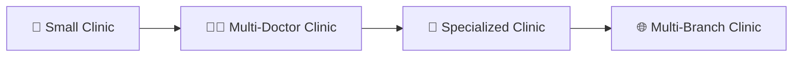

- 🎓 The **university version** focuses on core functionality first.
- 🚀 **Advanced commercial features** are added later.

---

## 👥 4. Target Users

The system supports multiple **user roles**.

### 4.1 🛡️ Super Admin
Responsible for complete system management.

- Manage users & roles
- Manage clinic settings
- View all reports
- Manage doctors & staff
- Manage services
- Access system-wide settings

### 4.2 👨‍⚕️ Doctor

- View appointments
- View assigned patients
- View patient history & previous visits
- Add consultation notes & diagnosis
- Create prescriptions
- Add follow-up dates

### 4.3 💁 Receptionist

- Register & search patients
- Create appointments
- Manage appointment queue
- Update patient information
- Manage basic billing
- Record payments

### 4.4 🧮 Accountant

- Manage invoices
- Record payments
- View pending payments
- Generate financial reports

### 4.5 🩹 Nurse / Assistant *(Possible future role)*

- Record patient vitals
- Appointment preparation
- View basic patient information
- Doctor assistance

### 🔑 Role Access Matrix

| Module | Super Admin | Doctor | Receptionist | Accountant |
|---|:---:|:---:|:---:|:---:|
| Users & Roles | ✅ | ❌ | ❌ | ❌ |
| Clinic Settings | ✅ | ❌ | ❌ | ❌ |
| Patients | ✅ | ✅ | ✅ | 👁️ |
| Appointments | ✅ | ✅ | ✅ | ❌ |
| Visits & Records | ✅ | ✅ | ❌ | ❌ |
| Prescriptions | ✅ | ✅ | ❌ | ❌ |
| Billing & Payments | ✅ | ❌ | ✅ (basic) | ✅ |
| Reports | ✅ | 👁️ (own) | ❌ | ✅ (financial) |

> ✅ Full access &nbsp;•&nbsp; 👁️ Limited / view access &nbsp;•&nbsp; ❌ No access

---

## 🔄 5. Complete System Workflow

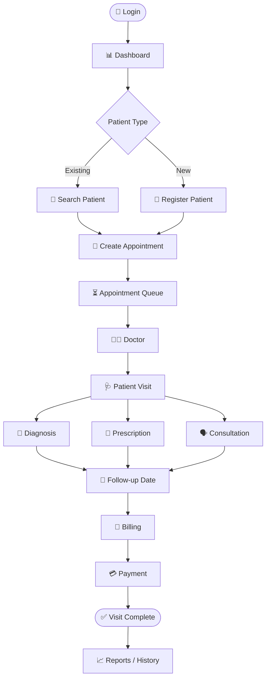

---

## 🏗️ 6. High-Level System Architecture

The project uses a **layered web architecture**.

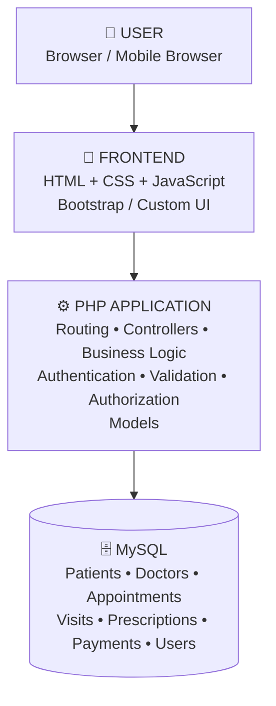

---

## 🧱 7. Application Architecture (MVC)

The project follows a **modular MVC-style architecture**.

| Layer | Responsibility |
|---|---|
| **Model** | Database interaction |
| **View** | User interface |
| **Controller** | Business logic / request handling |

**Example — "Add Patient":**

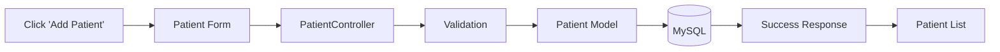

> 📌 This separation keeps the project **organized, maintainable and scalable**.

---

## 🗂️ 8. Proposed Folder Structure

```text
clinic-crm/
│
├── app/
│   │
│   ├── config/
│   │   ├── database.php
│   │   ├── app.php
│   │   └── constants.php
│   │
│   ├── controllers/
│   │   ├── AuthController.php
│   │   ├── DashboardController.php
│   │   ├── PatientController.php
│   │   ├── DoctorController.php
│   │   ├── AppointmentController.php
│   │   ├── VisitController.php
│   │   ├── PrescriptionController.php
│   │   ├── BillingController.php
│   │   ├── PaymentController.php
│   │   ├── ReportController.php
│   │   └── UserController.php
│   │
│   ├── models/
│   │   ├── User.php
│   │   ├── Patient.php
│   │   ├── Doctor.php
│   │   ├── Appointment.php
│   │   ├── Visit.php
│   │   ├── Prescription.php
│   │   ├── Invoice.php
│   │   ├── Payment.php
│   │   └── Service.php
│   │
│   ├── views/
│   │   ├── auth/
│   │   ├── dashboard/
│   │   ├── patients/
│   │   ├── doctors/
│   │   ├── appointments/
│   │   ├── visits/
│   │   ├── prescriptions/
│   │   ├── billing/
│   │   ├── reports/
│   │   └── users/
│   │
│   ├── middleware/
│   │   ├── AuthMiddleware.php
│   │   ├── RoleMiddleware.php
│   │   └── CsrfMiddleware.php
│   │
│   └── helpers/
│       ├── validation.php
│       ├── auth.php
│       ├── response.php
│       └── functions.php
│
├── public/
│   ├── index.php
│   ├── login.php
│   ├── assets/
│   │   ├── css/
│   │   ├── js/
│   │   ├── images/
│   │   └── icons/
│   └── uploads/
│
├── routes/
│   └── web.php
│
├── database/
│   ├── schema.sql
│   ├── seed.sql
│   └── migrations/
│
├── storage/
│   ├── logs/
│   └── backups/
│
├── docs/
│   ├── architecture.md
│   ├── database.md
│   ├── api.md
│   ├── workflow.md
│   └── user-manual.md
│
├── tests/
│
├── .env
├── .gitignore
└── README.md
```

> ℹ️ *The folder structure may evolve during development. Any change must be documented in this README.*

---

## 🛠️ 9. Technology Stack

| Layer | Technologies |
|---|---|
| 🎨 **Frontend** | HTML5 • CSS3 • JavaScript • Bootstrap / Custom CSS • Chart.js (dashboards & reports) |
| ⚙️ **Backend** | PHP 8+ • PDO • MVC-style architecture |
| 🗄️ **Database** | MySQL • phpMyAdmin (local development) |
| 💻 **Dev Environment** | XAMPP • VS Code • MySQL • phpMyAdmin • Git / GitHub |

### ☁️ Future Deployment

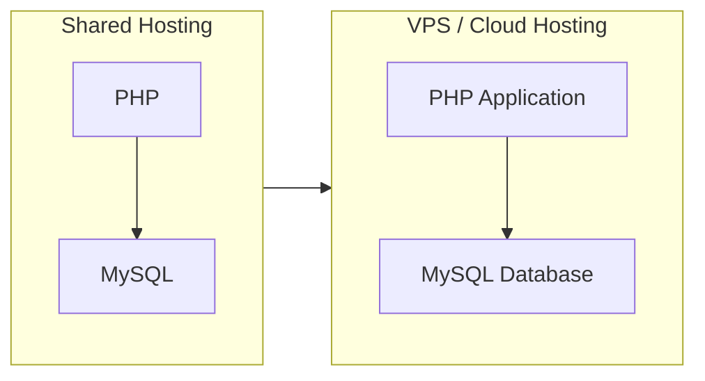

---

## 🗃️ 10. Core Database Entities

The initial database contains the following entities:

| | | | |
|---|---|---|---|
| `users` | `roles` | `patients` | `doctors` |
| `appointments` | `visits` | `prescriptions` | `prescription_items` |
| `services` | `invoices` | `payments` | `follow_ups` |
| `activities` | | | |

---

## 🔗 11. Simplified Database Relationships

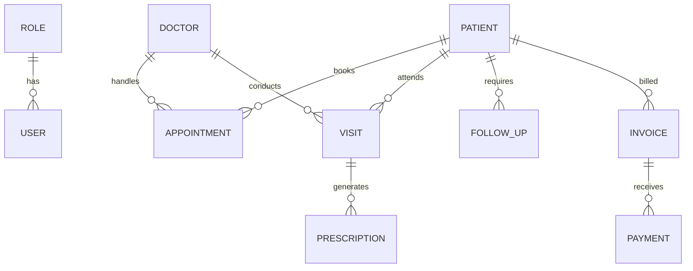

> 📐 *The exact ERD will be designed before database implementation.*

---

## 🧩 12. Core Modules

### 👤 12.1 Patient Management

**Patient Information**

`Patient ID` • `Full name` • `Gender` • `Date of birth / age` • `Phone` • `Email` • `Address` • `Emergency contact` • `Registration date` • `Blood group (if required)` • `Notes`

**Features**

- ➕ Add patient &nbsp; ✏️ Edit patient &nbsp; 👁️ View patient
- 🔎 Search patient &nbsp; 🗄️ Delete / archive patient
- 📜 Patient history &nbsp; 📅 Appointment history
- 🩺 Visit history &nbsp; 💰 Billing history

### 👨‍⚕️ 13. Doctor Management

- Doctor profile
- Specialization
- Contact information
- Availability
- Consultation fee
- Assigned appointments
- Patient history
- Doctor performance reports

### 📅 14. Appointment Management

**Features:** Create appointment • Select patient • Select doctor • Select date • Select time • Appointment status • Appointment notes • Reschedule • Cancel • Complete appointment

**Statuses**

| Status | Meaning |
|---|---|
| 🟦 Scheduled | Appointment booked |
| 🟩 Confirmed | Confirmed by patient / clinic |
| 🟨 Waiting | Patient arrived, waiting |
| 🟧 In Progress | Currently with doctor |
| ✅ Completed | Visit finished |
| ❌ Cancelled | Cancelled |
| 🚫 No Show | Patient did not arrive |

### 🩺 15. Visit / Consultation Management

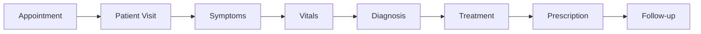

**Possible fields:** Chief complaint • Symptoms • Blood pressure • Temperature • Weight • Diagnosis • Doctor notes • Treatment • Prescription • Follow-up date

### 💊 16. Prescription Management

Doctors can create prescriptions linked to the relevant **visit** and **patient**.

**Example**

> **Patient:** Ahmed Ali

| Medicine | Strength | Dose | Frequency | Duration |
|---|---|---|---|---|
| Paracetamol | 500mg | 1 tablet | 2 times/day | 5 days |
| Medicine B | 250mg | 1 tablet | 1 time/day | 7 days |

### 💰 17. Billing & Payments

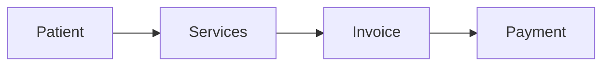

**Example Invoice**

| Item | Amount |
|---|---:|
| Consultation | Rs. 1,500 |
| Lab Test | Rs. 2,000 |
| Medicine | Rs. 800 |
| **Total** | **Rs. 4,300** |
| Paid | Rs. 3,000 |
| **Remaining** | **Rs. 1,300** |

**Payment Status:** `Paid` • `Partial` • `Pending` • `Refunded`

---

## 📊 18. Dashboard

The dashboard provides a **quick overview** of clinic activity.

**📌 Statistics**

| | | | |
|---|---|---|---|
| Total Patients | Today's Appointments | Today's Revenue | Pending Payments |
| Active Doctors | Upcoming Follow-ups | Cancelled Appointments | New Patients |

**📈 Charts**

- Daily appointments
- Monthly revenue
- New patients
- Doctor workload
- Appointment status
- Payment status

---

## 🔎 19. Search & Filtering

| Area | Search / Filter By |
|---|---|
| 👤 **Patient Search** | Name • Phone • Patient ID • Email |
| 📅 **Appointment Filtering** | Doctor • Date • Status • Patient |
| 💰 **Billing Filtering** | Date • Patient • Payment Status • Invoice Status |

---

## 🔐 20. Authentication & Authorization

Security is an important part of the project. The system includes:

- ✅ Login & Logout
- ✅ Password hashing
- ✅ Sessions
- ✅ Role-based access control (RBAC)
- ✅ CSRF protection
- ✅ Input validation
- ✅ SQL injection protection
- ✅ Access restrictions

| Role | Access |
|---|---|
| 🛡️ Admin | Everything |
| 👨‍⚕️ Doctor | Patients + Visits + Prescriptions |
| 💁 Receptionist | Patients + Appointments + Basic Billing |
| 🧮 Accountant | Invoices + Payments + Reports |

> ⚠️ **A user must never be able to access a module simply by manually entering its URL.**

---

## 🛡️ 21. Security Principles

Because the system handles potentially **sensitive clinic / patient information**, security is treated as a **core requirement**.

| Principle | Purpose |
|---|---|
| PDO Prepared Statements | Prevent SQL injection |
| Password Hashing | Protect credentials |
| Session Security | Prevent session hijacking |
| CSRF Protection | Prevent forged requests |
| Server-side Validation | Never trust client input |
| Output Escaping | Prevent XSS |
| Role Authorization | Restrict access by role |
| Secure File Upload Handling | Prevent malicious uploads |
| Environment Variables | Keep secrets out of code |
| Error Logging | Monitor and debug safely |

> 🚨 During development, **real patient data must not be used.** Use dummy / sample data for the university project.

---

## 🔄 22. Request Lifecycle

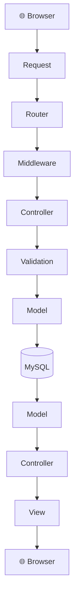

**Example — `GET /patients`**

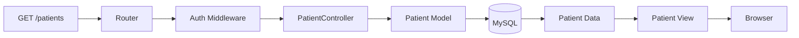

---

## 🧩 23. Development Roadmap

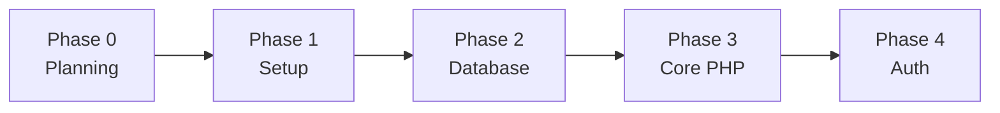

| Phase | Title | Key Deliverables |
|:---:|---|---|
| **0** | 📋 Project Planning | Finalize requirements • Define users, modules, workflow, architecture • Define database entities |
| **1** | ⚙️ Environment Setup | Install/configure XAMPP • Create project • Configure PHP & MySQL • Create database • Git init • Basic folder structure |
| **2** | 🗄️ Database Design | ERD • Tables • Primary & foreign keys • Relationships • Constraints • Indexes • Seed/sample data |
| **3** | 🧱 Core PHP Architecture | Routing • Database connection • Models • Controllers • Views • Helpers • Middleware |
| **4** | 🔐 Authentication | Login • Logout • Sessions • Password hashing • Roles • Permissions |
| **5** | 📊 Dashboard | Statistics • Cards • Tables • Charts • Recent activity |
| **6** | 👤 Patient Management | CRUD • Search • Filters • Patient profile • Patient history |
| **7** | 👨‍⚕️ Doctor Management | Doctor CRUD • Specialization • Availability • Doctor dashboard |
| **8** | 📅 Appointment Management | Booking • Scheduling • Status • Rescheduling • Cancellation • Appointment queue |
| **9** | 🩺 Visit & Medical Records | Consultation • Symptoms • Vitals • Diagnosis • Notes • Treatment |
| **10** | 💊 Prescription System | Prescription creation • Medicine items • Dosage • Duration • Prescription history |
| **11** | 💰 Billing | Services • Invoices • Payments • Outstanding balance • Payment history |
| **12** | 🔔 Follow-up System | Follow-up dates • Pending & completed follow-ups • Patient reminders |
| **13** | 📈 Reports & Analytics | Patient • Appointment • Revenue • Doctor • Payment reports |
| **14** | 🎨 UI/UX | Responsive design • Sidebar • Navbar • Tables • Forms • Modals • Notifications • Loading / Empty / Error states |
| **15** | 🧪 Security & Testing | Auth & authorization testing • Form validation • SQL injection • CSRF • Session • File upload • Error handling |
| **16** | 🚀 Deployment | Production configuration • Database deployment • Environment variables • SSL/HTTPS • Backup strategy • Error logging |
| **17** | 💼 Commercial Version | See below |

<details>
<summary><b>🚀 Phase 17 — Future Commercial Features</b></summary>

<br>

- Multi-clinic support
- Multi-branch support
- Subscription plans
- Online appointment booking
- SMS / email notifications
- WhatsApp integration
- Online payments
- Advanced analytics
- Automated reminders
- Audit logs
- Backup management
- API
- Mobile application
- SaaS architecture

</details>

---

## 📈 24. Project Development Strategy

> **We will not build everything at once.**

Each module follows this cycle:

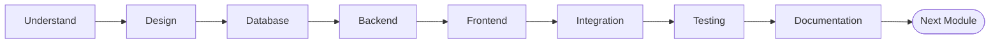

This prevents the project from becoming confusing.

---

## 🧪 25. Testing Strategy

Every module must be **tested before moving forward**. A testing checklist is maintained throughout development.

**Example — Patient Module**

- [ ] Add patient
- [ ] Edit patient
- [ ] View patient
- [ ] Search patient
- [ ] Delete / archive patient
- [ ] Invalid input
- [ ] Duplicate data
- [ ] Unauthorized access

---

## 📚 26. Documentation Strategy

```text
README.md
docs/
├── architecture.md
├── database.md
├── workflow.md
├── api.md
├── security.md
├── testing.md
└── user-manual.md
```

> 📖 This README acts as the **master project document**.

---

## 🧠 27. Project Rules

These rules must be followed throughout development:

| # | Rule |
|:---:|---|
| 1 | Do not randomly change the architecture. |
| 2 | Every new feature must have a clear purpose. |
| 3 | Database relationships must be planned before implementation. |
| 4 | Never put database queries randomly throughout HTML files. |
| 5 | Use prepared statements. |
| 6 | Validate data on the server side. |
| 7 | Use role-based authorization. |
| 8 | Do not use real patient data during development. |
| 9 | Test each module before starting the next major module. |
| 10 | Update this README when an important architectural decision changes. |

---

## 🎓 28. University Project Scope

The university submission demonstrates:

| | | |
|---|---|---|
| PHP | MySQL | HTML |
| CSS | JavaScript | Database Design |
| CRUD | Authentication | Authorization |
| Sessions | Relationships | Business Logic |
| Reports | Security | Software Architecture |

> 🎯 The goal is **not merely to show a website** — the goal is to demonstrate a **complete software system**.

---

## 💼 29. Commercial Product Vision

After completing the university version, the project can evolve into a **commercial Clinic Management SaaS**.

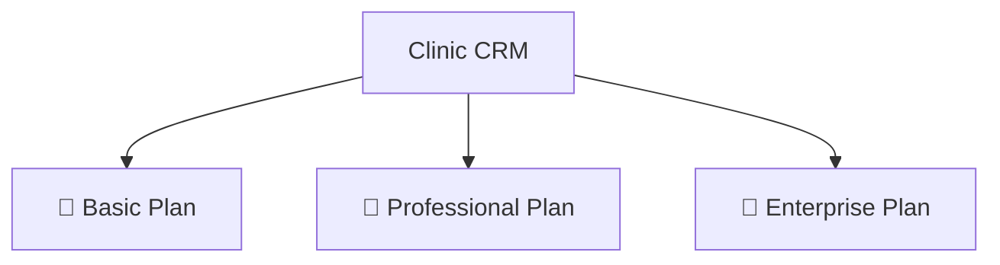

**Potential customer journey**

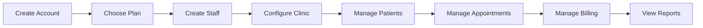

> 🔒 The commercial architecture must support **tenant isolation** — one clinic's data must **never** be accessible to another clinic.

---

## 🚀 30. Future SaaS Architecture

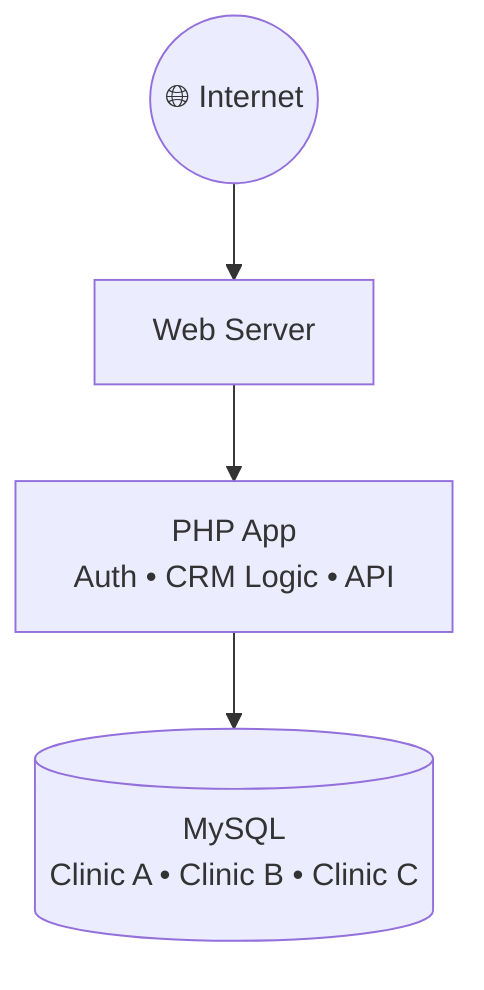

> ⏳ *This will not be implemented immediately. It is part of the long-term product roadmap.*

---

## 🧭 31. Current Project Status

| | |
|---|---|
| **Project** | Clinic CRM |
| **Status** | 🟡 Planning |
| **Current Phase** | Phase 0 — Project Planning |

**✅ Completed**

- [x] Project idea
- [x] Clinic CRM concept
- [x] Basic workflow
- [x] Initial architecture
- [x] Technology stack
- [x] Initial folder structure
- [x] Development roadmap

**⏭️ Next**

- [ ] Final requirements
- [ ] Final modules
- [ ] Database ERD
- [ ] Database schema
- [ ] Phase 1 setup

---

## 📌 32. Important Development Principle

This project is built **gradually**. We will not jump directly into writing hundreds of lines of PHP.

For every major component:

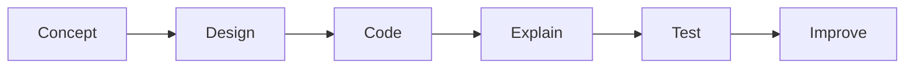

> 💡 The purpose is that the developer **understands why the code exists**, not just copies it.

---

## 🏁 33. Definition of Done

A module is considered **complete** only when:

- [x] UI completed
- [x] Backend completed
- [x] Database integrated
- [x] Validation implemented
- [x] Authorization implemented
- [x] Error handling implemented
- [x] Tested
- [x] Cleaned / refactored
- [x] Documented

---

## 🎯 34. Final Project Goal

> **A professional, secure, modular and scalable Clinic CRM web application using PHP and MySQL, suitable for university demonstration and capable of evolving into a real commercial clinic-management product.**

- 🎓 The **university version** establishes the foundation.
- 🚀 The **commercial version** builds upon that foundation instead of requiring a full rewrite.

---

## 👋 35. Outro

This README is the **single source of truth** for the Clinic CRM project.

Whenever development stops and resumes later, continue by checking:

1. Current Project Status
2. Current Phase
3. Completed Modules
4. Pending Tasks
5. Database Changes
6. Architecture Decisions
7. Next Development Step

The project evolves phase by phase until the complete Clinic CRM is operational.

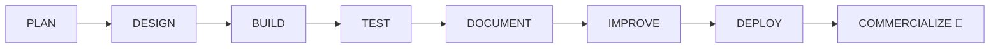

---

<div align="center">

### 📋 Project Summary

| | |
|---|---|
| **Project Name** | Clinic CRM |
| **Type** | Web-Based Clinic Management & CRM System |
| **Backend** | PHP |
| **Database** | MySQL |
| **Frontend** | HTML + CSS + JavaScript |
| **Architecture** | Modular MVC-style |
| **Development Approach** | Phase-by-phase |
| **Long-Term Goal** | Commercial / SaaS-ready Clinic CRM |

<br>

**Built with ❤️ for better healthcare management**

⭐ *Plan → Design → Build → Test → Document → Improve → Deploy → Commercialize* ⭐

</div>
