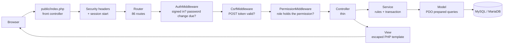

# Architecture

Clinic CRM is a small, framework-free **MVC-style** PHP application. The goal is code a student can read top to bottom and explain, while still enforcing the rules a real clinic needs (permissions, money accuracy, audit, no double booking).

## 1. Request lifecycle

* **`public/index.php`** is the only PHP file the web server executes. It sends the security headers, starts the session and dispatches.
* **Router** (`app/Core/Router.php`): `routes/web.php` maps `METHOD /pattern` → `[Controller::class, 'method']` plus an access rule (`->can([...])`, `->any()` for "any signed-in user", `->public()` for the login page). **A route without a rule is denied** (`PermissionMiddleware`).
* **Middleware order matters:** signed in → CSRF → permission. Anonymous requests never reach the CSRF or permission checks; every POST needs a token before any permission logic runs.
* **Controllers** read input, call a service, and return a `Response` (view, redirect, JSON, CSV). They contain no SQL and no business rules.
* **Services** (`app/Services`) own business rules and transaction boundaries. They throw `BusinessRuleException` with a message written for staff; controllers show it as a banner or form error.
* **Models** (`app/Models`) are thin PDO wrappers; every query uses prepared statements with bound parameters.
* **Views** (`app/Views`) are PHP templates. Every value is printed through `e()` (or a helper that escapes internally); `tests/lint.php` fails the build if a template echoes a bare variable.

## 2. Layers and responsibilities

| Layer | Folder | Knows about | Must not |
|---|---|---|---|
| Config constants | `app/Config` | role codes, permission codes, status machines | contain logic that touches the database |
| Core | `app/Core` | HTTP, session, CSRF, validation, money, DB connection | know about clinic concepts (except `Auth`, which loads the user) |
| Controllers | `app/Controllers` | request → service → response | run SQL or enforce money/scheduling rules |
| Services | `app/Services` | rules, transactions, audit | render HTML |
| Models | `app/Models` | SQL | decide permissions or business rules |
| Views / Helpers | `app/Views`, `app/Helpers` | presentation | query the database (only `setting()` reads a cached setting) |

## 3. Cross-cutting design decisions

### Money is never a float
Amounts live in `DECIMAL(10,2/12,2)` columns. In PHP they are converted to **integer minor units** (paisa) by `App\Core\Money`, added/subtracted as integers, and converted back to `"1500.50"` strings. Tax uses half-up integer rounding. This is why `0.10 × 3` is exactly `0.30` (unit-tested). Dashboard/report services return minor-unit integers; the view helper `money_minor()` formats them, while `money()` formats database `DECIMAL` strings.

### Transactions and locking (what is atomic)

| Operation | Transaction | Lock | Why |
|---|---|---|---|
| Register patient | yes | sequence row | patient code + insert + audit succeed together; a failed attempt does not burn a number |
| Book / reschedule appointment | yes | `SELECT … FOR UPDATE` on the **doctor** row, plus DB `UNIQUE` key | simultaneous bookings for one doctor are serialized; the unique key is the final guard |
| Walk-in, check-in (queue number) | yes | doctor row | queue numbers cannot repeat |
| Change appointment status | yes | appointment row | two staff cannot move it at once |
| Start consultation | yes | appointment row | creates exactly one draft visit |
| Save draft / finalize / amend | yes | visit row | status change, prescription, follow-up, amendment history together |
| Create invoice | yes | sequence row | header + lines + number + audit together |
| Payment / refund / adjustment / void | yes | **invoice** row | the ledger row and the recalculated invoice totals commit together; concurrent payments cannot overpay |
| Create doctor + login | yes | — | both rows or neither (automated test) |

`Database::transaction()` joins an already-open transaction, which is also how the integration tests wrap each test in a rolled-back transaction.

### Double-booking protection (two layers)
1. **Service layer:** `AppointmentService` locks the doctor row, recomputes the free slots (schedule ∩ clinic hours − existing bookings, with real overlap tests) and rejects a taken or non-existent slot.
2. **Database layer:** `appointments.active_slot` is a *stored generated column* equal to the start time while a *scheduled* appointment still holds the slot (NULL when cancelled/no-show or for walk-ins). A `UNIQUE (doctor_id, appointment_date, active_slot)` key makes the database itself refuse a duplicate. An HTTP test fires six parallel requests at one slot; exactly one booking results.

### Append-only records
Database triggers reject `UPDATE`/`DELETE` on `payments`, `audit_logs`, `visit_amendments`; `DELETE` on `invoices` and on finalized `visits`. Corrections are new rows (refund, adjustment, amendment, void).

### Numbering
`number_sequences` + `UPDATE … SET last_value = LAST_INSERT_ID(last_value + 1)` hands out `PT-`, `INV-yyyy-`, `RCT-/RFD-/ADJ-`, `RX-` numbers without gaps or collisions (the row lock lasts until the surrounding transaction ends).

### Authorization = permission **and** ownership
Permission codes say *what kind* of action a role may perform; `AccessPolicy` adds *which records*: a doctor only sees their own appointments/queue and only patients with a **care relationship** (a non-cancelled appointment or a recorded visit). Clinical content is reachable only through `visits.*` permissions, which only doctors hold, and only for the treating doctor to edit.

### Error handling and logging
`ErrorHandler` converts PHP warnings into exceptions, logs details to `storage/logs/app.log` (no passwords/tokens), and renders a friendly page: 403, 404, 419 (expired form), 503 (database unreachable) or 500. Stack traces appear on screen only when `APP_DEBUG=true`. Validation errors return to the form with the user's input (never passwords) and per-field messages.

### Front end
No build step. `public/assets/css/tokens.css` (design tokens) + `app.css` + `print.css`; `public/assets/js/app.js` provides progressive enhancement (mobile menu, confirm dialogs, button loading states, patient search, slot picker, repeating rows, invoice estimate, charts). There are **no inline scripts**, which lets the Content-Security-Policy forbid them.

## 4. Configuration
`.env` → `App\Core\Env` → `config/*.php` → `Config::get('database.name')`. Real environment variables win over the file. Nothing secret is committed (`.env` is git-ignored; `.env.example` documents every key).

## 4b. Trade-off: static helpers (global state)

`Auth`, `Session`, `Config`, `Env`, `Database` (the PDO connection) and `Setting` (cached settings) are **static classes**. That is global, per-request state, which a framework would replace with dependency injection. It was chosen on purpose: it keeps every call site one short line a student can read (`Auth::can('x')`, `Database::one(...)`), and PHP's one-request-per-process model means the state never leaks between users. The cost is test ergonomics, handled with explicit seams: `Auth::actingAs()/reset()`, `Setting::forget()`, `Database::disconnect()`, `Config::set()`, and the integration tests' rolled-back transactions. There is no other mutable global state.

## 5. Deviations from the suggested structure

| Suggested | What was done | Reason |
|---|---|---|
| `app/Core` not listed | added `app/Core` | router, session, CSRF, validator, money, DB layer are framework pieces that belong together |
| `database/seed.sql` | `database/seed.php` (+ `bin/seed-demo.php`) | demo dates must be relative to the day of installation and invoices/payments must stay arithmetically consistent; a static SQL file would be stale on day two. The seed is tested for internal consistency. |
| `database/migrations/` | folder + documented process | baseline is `schema.sql`; no changes since v1 |
| Bootstrap CSS "if it fits" | own CSS | smaller, matches the supplied tokens, no framework to explain |
| `docs/user-manual.md`, `requirements.md`, `workflow.md` ... | all present | see README index |
| `prompt.md` in project | copied to the root | the master prompt is part of the project record |

## 6. Where to extend

* **New module:** table in `schema.sql` → Model → Service (rules, transactions, audit) → Controller → routes with a permission → Views → tests. Add the permission to `Permissions.php`, `schema.sql` (permissions + role mapping) and the matrix test.
* **Multi-clinic:** add `clinic_id` filters in Models using `Auth::user()['clinic_id']`; the columns already exist on users/patients/services/invoices/settings.
* **Patient portal:** `patients.user_id` and the reserved `patient` role exist; add portal-only routes and a stricter policy.
* **Notifications:** add a queue table and a CLI worker; follow-ups already store dates and status.
