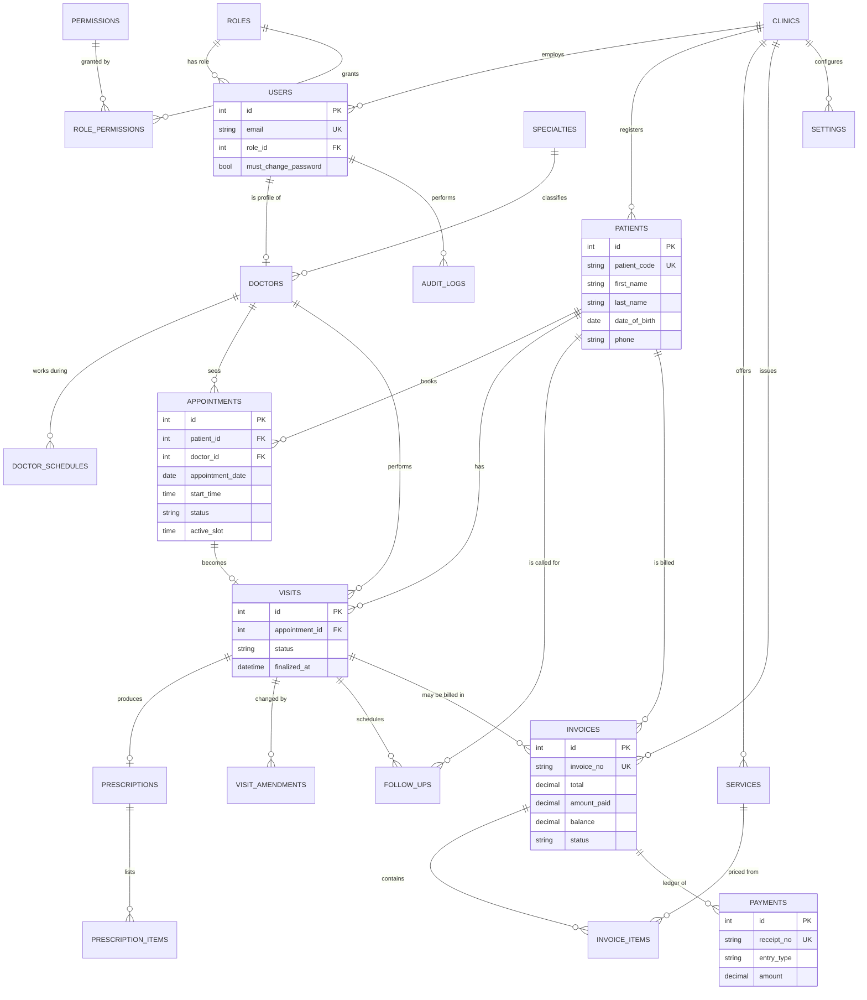

# Database design

* Engine **InnoDB**, charset **utf8mb4**, collation `utf8mb4_unicode_ci` (case/accent-insensitive comparisons — the duplicate-patient key relies on this).
* 23 tables. Structure, triggers and fixed reference data are in `database/schema.sql`; demo data in `database/seed.php`.
* Verified by automated tests: every table has a primary key; no money column is floating-point; foreign keys never cascade deletes except for pure child rows; impossible values are rejected by `CHECK`s; the append-only triggers fire.

## Entity-relationship diagram

(Plain-text version of the main chain: `patients → appointments → visits → prescriptions(+items)`, `visits → follow_ups`, `patients/visits → invoices → invoice_items`, `invoices → payments`.)

## Tables

| Table | Purpose | Notable constraints |
|---|---|---|
| `clinics` | The clinic(s) | one row today |
| `roles`, `permissions`, `role_permissions` | RBAC reference data | seeded by `schema.sql`; a test pins the exact matrix |
| `users` | Staff accounts | `email` unique; `must_change_password`; no patient logins yet |
| `login_attempts` | Sign-in throttling | indexed by (email, IP, time) |
| `settings` | Key/value clinic settings per clinic | PK (clinic_id, key) |
| `number_sequences` | Gap-free counters | row-locked inside the issuing transaction |
| `specialties` | Departments | unique name, soft-disable |
| `doctors` | Professional profile 1-to-1 with a user | `user_id` unique; fee ≥ 0; visit length 5-120 |
| `doctor_schedules` | Weekly working windows | ISO weekday 1-7; `end_time > start_time` |
| `patients` | Demographics | `patient_code` unique; **`UNIQUE(first_name, last_name, date_of_birth, phone)`** blocks duplicates; archived instead of deleted |
| `appointments` | Bookings and walk-ins | **`UNIQUE(doctor_id, appointment_date, active_slot)`**; `end_time > start_time`; status enum |
| `visits` | Consultation record | own `Draft/Finalized` status; unique per appointment; finalized visits cannot be deleted (trigger) |
| `visit_amendments` | Before/after JSON + who/when/why | append-only (triggers) |
| `prescriptions`, `prescription_items` | One prescription per visit, ordered lines | `prescription_no` unique |
| `follow_ups` | Reminders | status Pending/Completed/Cancelled |
| `services` | Billable services | unique name per clinic; price ≥ 0 |
| `invoices`, `invoice_items` | Billing documents | `invoice_no` unique; cannot be deleted (trigger); item quantity ≥ 1 |
| `payments` | **Ledger** of payments, refunds, adjustments | `amount > 0`; append-only (triggers); `receipt_no` unique |
| `audit_logs` | Who did what | append-only (triggers) |

## Key design decisions

1. **Appointment status ≠ visit status ≠ invoice status.** An appointment can be *Completed* while its invoice is still *Unpaid*. Each has its own state machine (see [workflow.md](workflow.md)).
2. **Invoice amounts are derived from the ledger.** `amount_paid`, `adjusted_amount`, `balance`, `status` are cached on the invoice for fast lists but are **recalculated from `payments` inside the same transaction** after every ledger entry; a seed-integrity test checks `balance = total − paid − adjusted` and `paid = payments − refunds` across 900+ invoices.
3. **No hard deletes of history.** Patients are archived; doctors/users/services/specialties are deactivated; invoices are voided; payments are corrected with refunds/adjustments; clinical records are amended with history.
4. **Foreign keys use `RESTRICT`** (the default) except `role_permissions`, `doctor_schedules`, `prescription_items`, `invoice_items`, which are pure children and use `CASCADE`.
5. **`active_slot` generated column** turns "no double booking" into a database guarantee (see architecture.md).
6. **Prices are snapshotted.** Invoice lines copy the description and unit price at creation; later price changes never alter issued invoices.
7. **Indexes** exist for the actual query patterns: patient name/phone/registration date, appointment (date, doctor) / patient / status, visits by patient+date and doctor+date, follow-ups (date, status), invoices (date, status) / patient / visit, payments by invoice and date, audit by date/entity/user, login attempts by (email, IP, time).
8. **Time:** dates are `DATE`, times `TIME`, moments `DATETIME` in the application time zone; the connection sets `time_zone` to PHP's offset so `NOW()` and PHP agree.
9. **Personal data minimisation:** phone is required (front desk needs it); email, address, blood group, emergency contact are optional; no government ID, no photo, no free-text medical history outside visits.
10. **Multi-clinic readiness:** `clinic_id` exists on `users`, `patients`, `services`, `invoices`, `settings`. Queries are **not** yet filtered by it (documented limitation).

## Reference data and seed data

* `schema.sql` inserts: the clinic row, 5 roles, 35 permissions, the role-permission matrix, default settings (clinic name, currency `Rs.`/`PKR`, hours 09:00-21:00, tax 0%), and the four number sequences. **It contains no user accounts and no passwords.**
* `database/seed.php` (via `php bin/install-db.php --seed` or `php bin/seed-demo.php`) creates **fictional** data: 10 staff (incl. 6 doctors with schedules), 48 patients, about 1,200 appointments over 45 days back and 7 days ahead, visits with prescriptions, invoices with realistic payment states, follow-ups, a few audit rows. It uses a fixed random seed (same story each run, dates relative to today) and **refuses to run if any user exists**.

## Backup and recovery
See [setup.md](setup.md#backup-and-restore). A restored database keeps all triggers (tested).
