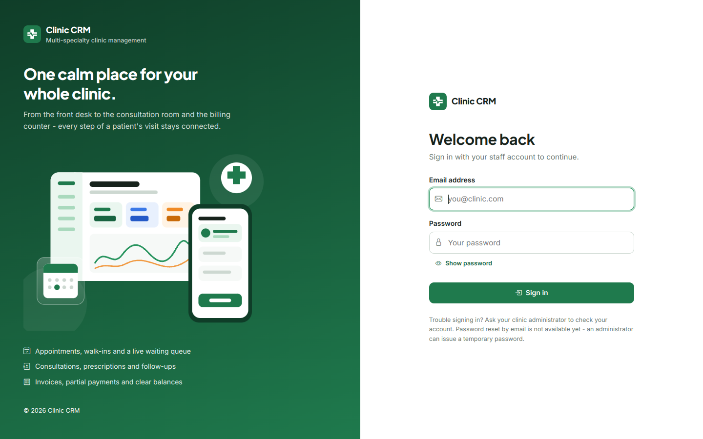
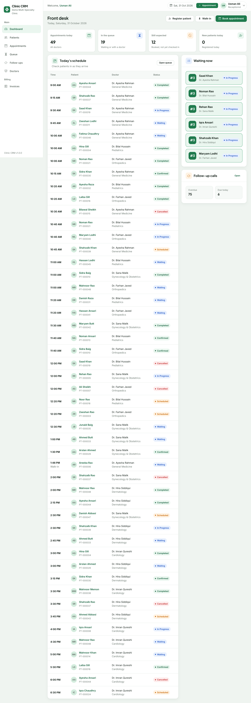
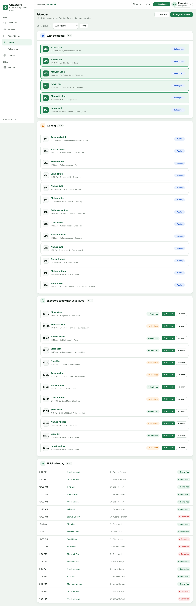
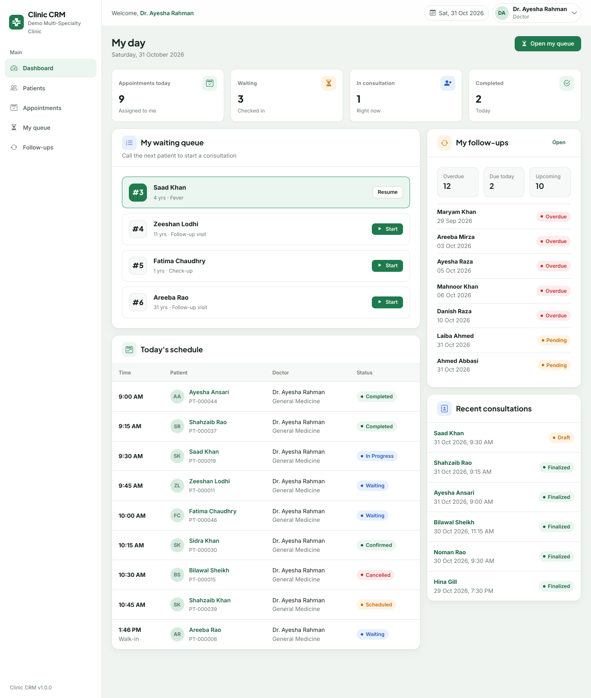
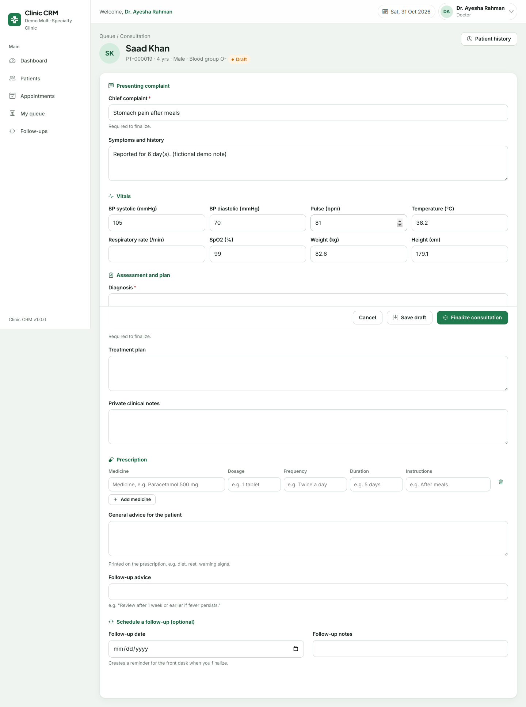
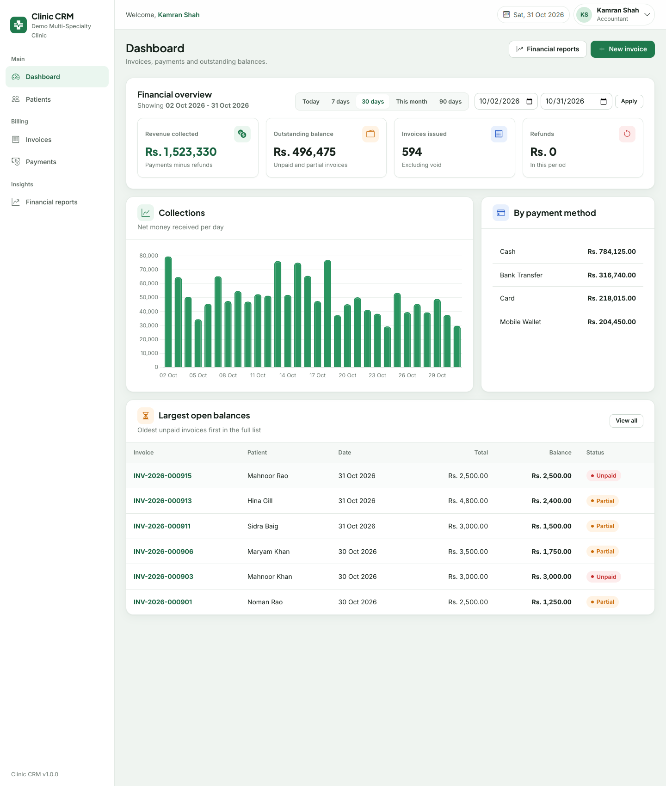
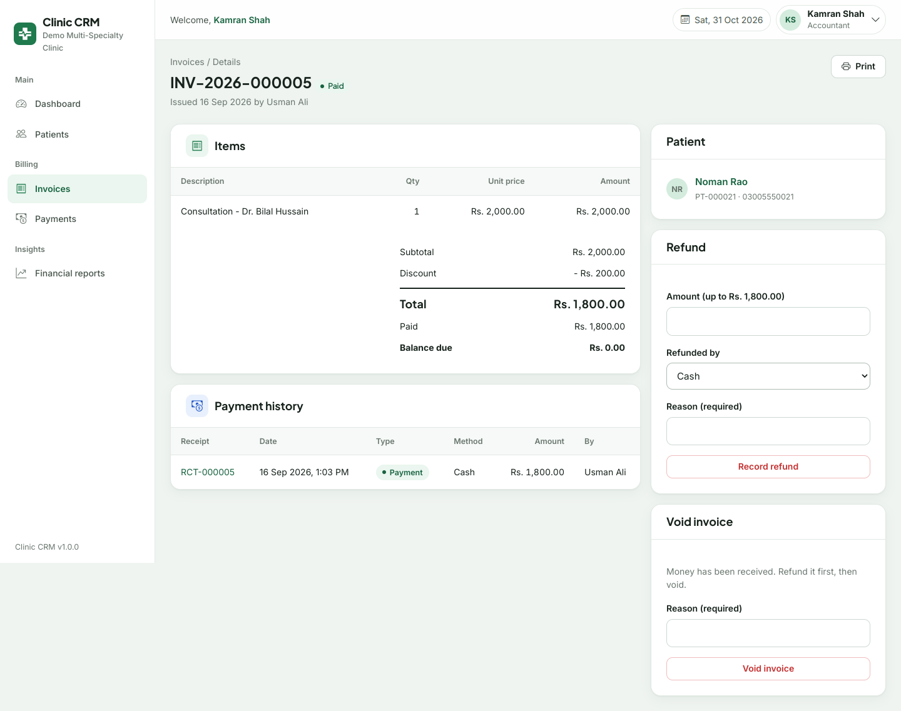
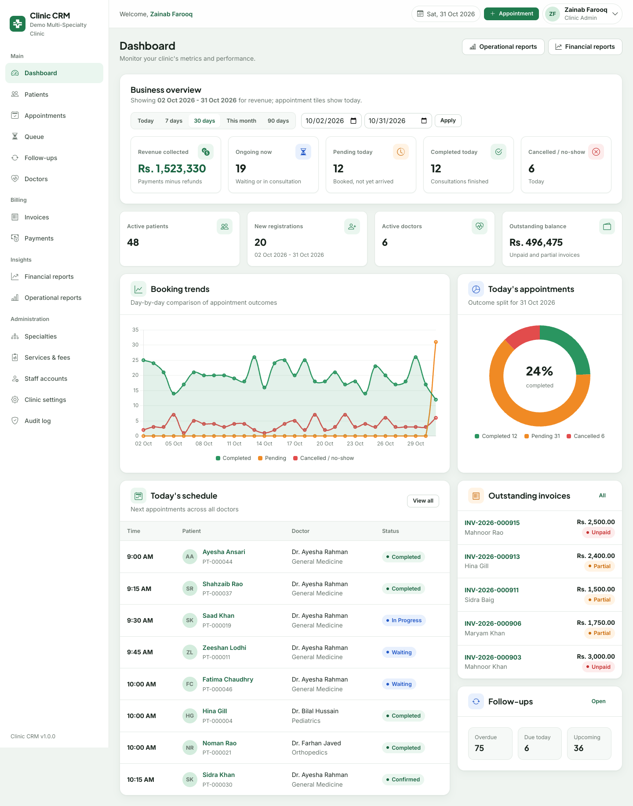

# User manual

For clinic staff. Screenshots show fictional demo data. Your menu shows only what your role may use; if you open a page you are not allowed to see, you get an "Access denied" page.

## 1. Signing in and out
1. Open the clinic's Clinic CRM address, enter your **email** and **password**, click **Sign in**.
2. First time (or after an administrator resets your password) you must choose a new password: at least **10 characters with letters and numbers**, different from the temporary one.
3. To leave, open your name (top right) → **Sign out**. Sessions also end after **30 minutes without activity** (a notice appears).
4. After **5 wrong attempts** in a row sign-in pauses for about 15 minutes. If you are locked out or forgot your password, ask the clinic administrator for a temporary password — there is no automatic e-mail reset.

## 2. Common things on every page
* **Search and filters** sit above each table; **Reset** clears them.
* Status colours always come with a word (e.g. *Waiting*), so they remain readable without colour.
* Risky actions (cancel, void, archive, refund, finalize) ask you to confirm and explain the consequence.
* Red text under a field explains what to fix; what you typed is kept.
* Tables scroll sideways on a phone; use the ☰ button for the menu.

---

## 3. Front desk (Receptionist)

**Register a patient** — *Patients → Register patient*. Fill the required fields (marked *). Phone is required; email, address and emergency contact are optional. If the same name + date of birth + phone already exists you are shown the existing record. The system assigns an ID such as `PT-000123`.

**Find a patient** — *Patients* → type part of the name, the ID or the phone number.

**Book an appointment** — *Book appointment*: search the patient, choose a doctor and a date, then click a free time. Greyed/struck-through times are taken. Add a reason if useful, then **Book appointment**. If someone books the same time a second earlier you will be told and can choose another.

**Reschedule or cancel** — open the appointment: **Reschedule** (pick a new date and time) or **Cancel appointment** (a reason is required; the time becomes free again).

**Patient arrives** — on the day, open *Queue* → **Check in** next to the patient. They get the next queue number for that doctor. If they do not come, **No-show**.

**Walk-in (no booking)** — *Register walk-in*: choose the patient (or register them first), choose a doctor who is on duty now, **Add to queue**.

**Invoice and payment** — *Invoices → New invoice* (or **Create invoice** on a finished visit): tick the consultation fee, add services, optional discount → **Create invoice**. Open the invoice → **Record payment** (amount, method, optional reference). You can take several payments. You cannot accept more than the balance. Receipts print from the invoice.

**Follow-up calls** — *Follow-ups* lists who the doctor asked to come back. Tabs: *Overdue, Due today, Upcoming*. After phoning, click **Done**. (Nothing is sent automatically.)

---

## 4. Doctor

**Your day** — the dashboard shows your waiting patients, schedule, follow-ups and recent consultations. You see only **your** appointments and patients you have treated or are booked with.

**See a patient** — *Queue* → **Start consultation** (patient must be *Waiting*). This opens the consultation form and marks the appointment *In Progress*.

**Write the consultation** — complaint, symptoms, vitals (checked for plausible ranges), diagnosis, plan, private notes, prescription lines (**Add medicine**; each needs medicine, dosage, frequency, duration), general advice, optional follow-up date.
* **Save draft** keeps your work; you can return from the queue (**Resume**).
* **Finalize consultation** needs a chief complaint and a diagnosis. After finalizing the record is locked and the appointment is *Completed*.

**Correct a finalized record** — open the visit → **Amend**: change what is needed and **state the reason**. The old version stays in the amendment history with your name and the time. Nobody can delete that history.

**Prescription** — visit page → **Prescription** → **Print**. The application does not check drug interactions or give medical advice; you are responsible for the content.

**Follow-ups** — add one while finalizing, or from a patient's page (*Add follow-up*). Mark them *Done* or cancel them from *Follow-ups*.

---

## 5. Accountant

* **Invoices** — search by number, patient name or ID; filter by status and dates; *Balance due only*.
* **Open an invoice** to see lines, totals and the full payment history. Actions available to you:
  * **Record payment**, **Refund** (up to what was paid, reason required), **Write off / adjust** (reduces the balance without money, reason required), **Void invoice** (reason required; only when no money is held — refund first).
  * Payments and refunds are **permanent entries**; mistakes are corrected with a new entry, never by editing.
* **Payments** — the ledger of all entries; export CSV.
* **Financial reports** — collected money, invoiced totals, outstanding balances, by method, by doctor, top services, for the date range you choose.
* You see patients' name, ID and phone only — no medical information.

---

## 6. Clinic Admin

* **Dashboard** — revenue (for the chosen range), ongoing patients, today's outcomes, new registrations, outstanding balance, booking trends.
* **Staff accounts** — create (a temporary password is shown **once** — pass it on privately), edit, **Reset password**, **Deactivate** (never delete). The last active admin cannot be deactivated or demoted, and you cannot deactivate yourself.
* **Doctors** — *New doctor* creates the login and the professional profile together; set fee, visit length and **weekly working hours** (overlapping or out-of-hours windows are refused). Deactivating a doctor requires that they have no upcoming appointments.
* **Specialties**, **Services & fees** — price changes affect new invoices only.
* **Clinic settings** — name, contact, opening hours, currency, tax rate, invoice footer.
* **Reports** — operational (appointments, no-shows, walk-ins, new patients, by doctor) and financial.
* **Audit log** — who did what and when (filter by date, action, user). Entries cannot be changed or deleted.
* Admin **cannot** read clinical records or record/refund payments by design.

---

## 7. Glossary
| Term | Meaning |
|---|---|
| Walk-in | Patient without a booking; added straight to the queue |
| Queue number | Order of arrival per doctor per day |
| Draft / Finalized | State of a consultation record |
| Amendment | A recorded change to a finalized consultation |
| Partial | Invoice with some payment but a balance remaining |
| Adjustment (write-off) | Balance reduced without receiving money |
| Void | Cancelled invoice kept for the record |
| Archive | Hide a patient from searches while keeping all history |

## 8. Frequently asked questions
* **"Form expired"** — your session ended or the page was open too long. Reload and try again.
* **I cannot find a free time** — the doctor may not work that day (see *Doctors → profile*) or the day is full; try another date.
* **Why can't I finish an appointment from the appointment page?** Appointments complete automatically when the doctor finalizes the consultation.
* **Why is "Check in" missing?** Check-in is only offered on the appointment's date.
* **A patient was registered twice** — the system prevents exact duplicates; if you find a near-duplicate, archive the wrong record (history is kept).
* **Can I delete an invoice or payment?** No. Void the invoice or add a refund/adjustment.
