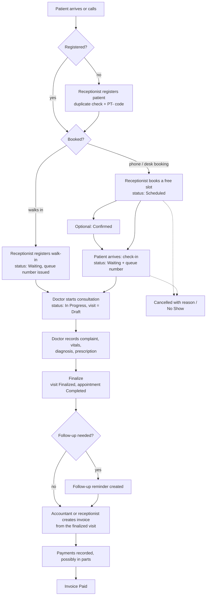
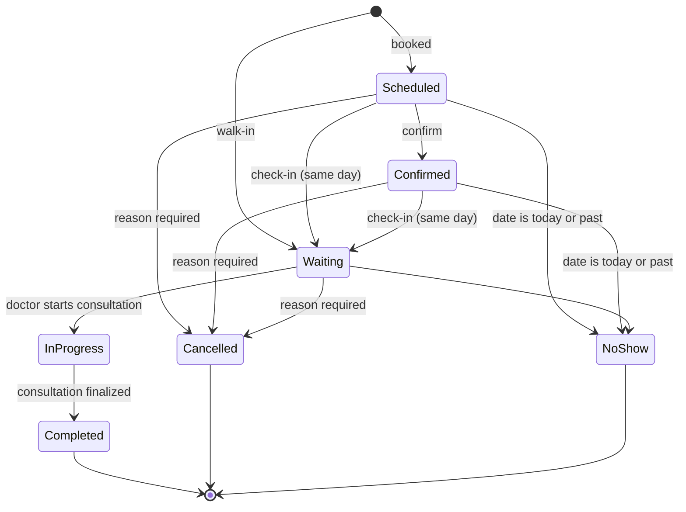
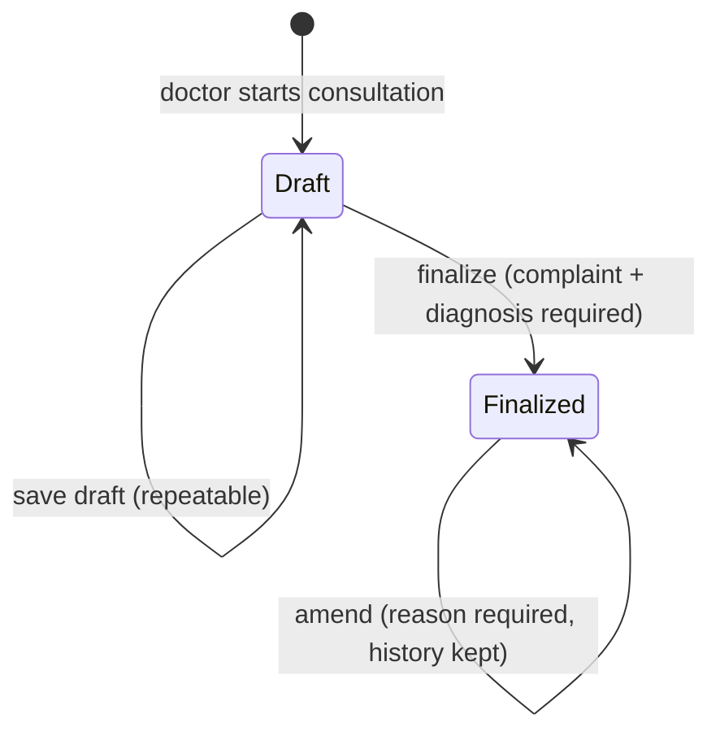
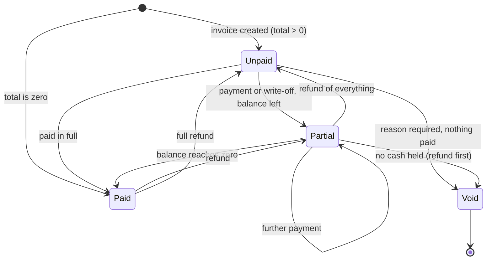
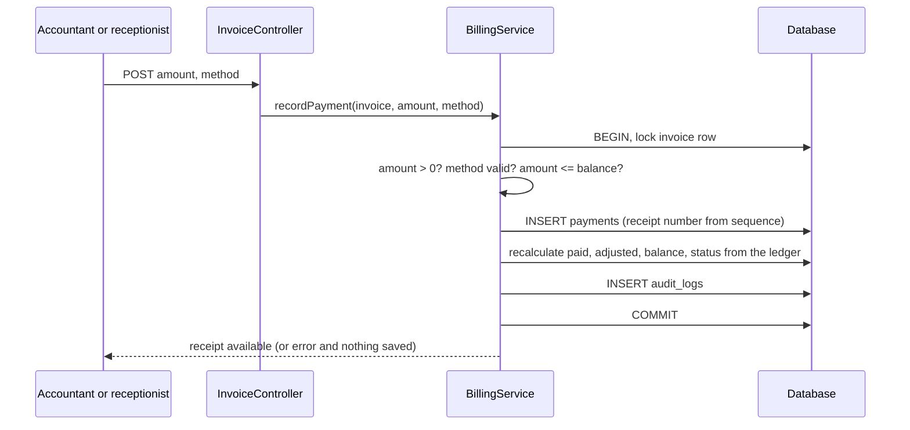

# Business workflow

This document describes how one patient visit moves through the system, which role does each step, and the rules enforced at each transition. Every rule below is implemented in a service class and covered by an automated test (names in brackets refer to test files).

## 1. The patient journey

## 2. Appointment status machine

Rules (`AppointmentStatus`, `AppointmentService`; tests: *status machine*, *check-in assigns queue numbers*):

* Only these arrows exist; everything else is refused with a message.
* **In Progress** and **Completed** can only be set by the consultation workflow — never by a button — so an appointment cannot be "completed" without a consultation.
* Check-in is only possible on the appointment date. No-show cannot be set for a future date.
* Cancelling requires a reason, frees the slot (database `active_slot` becomes NULL) and keeps the record.
* Rescheduling is allowed only for *Scheduled/Confirmed* booked appointments, to a free slot on today or later, and returns the status to *Scheduled*.
* A patient cannot hold two active appointments with the same doctor on the same day.

### Slot availability
`slots = doctor weekly windows ∩ clinic opening hours`, split into the doctor's visit length, minus overlapping existing bookings, minus times already past today. A slot must be one of these computed slots; "10:07" or a time on a day the doctor does not work is refused.

### Walk-ins
Allowed only while the clinic is open **and** the doctor has a working window covering the current time. They skip the slot grid (no time-slot lock), get the next queue number for that doctor and day, and start as *Waiting*. A patient with an active booking today is told to use check-in instead.

## 3. Consultation (visit) lifecycle

* Only the **treating doctor** can edit; other doctors get 403 (HTTP test *cannot open or edit another doctor's consultation*).
* **Finalize** in one transaction: validates, saves clinical fields and prescription, marks the visit *Finalized*, moves the appointment to *Completed*, creates the optional follow-up, audits.
* **Amend** stores a before/after JSON snapshot in `visit_amendments` with user, time and mandatory reason; "no changes" is refused; the history is shown to the doctor on the visit page and cannot be edited or deleted (triggers).
* Vital-sign limits are plausibility checks to catch typos (e.g. systolic 50-260, SpO2 50-100, temperature 30-45 °C); they are not clinical decision support.
* Walk-in visits do not need a pre-booked appointment: the walk-in is itself an appointment record of type *Walk-in*, so the same consultation workflow applies (`visits.appointment_id` is nullable in the schema for future "visit without any appointment" use).

## 4. Follow-ups

`Pending → Completed | Cancelled`. A pending follow-up is **Overdue** if its date is before today, **Due today**, or **Upcoming**. Created by the doctor during finalization or later from the patient page; completed or cancelled by the doctor, receptionist or admin (doctors only for their own). No messages are sent.

## 5. Billing

### Invoice and payment states

### Posting a payment (one transaction)

Rules (`BillingService`; tests in `BillingTest.php`):

* **Prices come from the database** (doctor profile, service list) — the browser sends only IDs and quantities.
* Totals: `subtotal = Σ(unit × qty)`; `discount ≤ subtotal`; `tax = round_half_up((subtotal − discount) × rate)`; `total = subtotal − discount + tax`; all in integer minor units.
* **Overpayment is refused** (payment ≤ balance). Policy choice: no credit balances in the MVP.
* **Refund** ≤ money currently paid; reason required; restores the balance.
* **Adjustment (write-off)** ≤ balance; reason required; reduces the balance without cash and is reported separately from collections.
* **Void** needs a reason and zero net money held (refund first); a void invoice accepts nothing further; the invoice number is never reused.
* A finalized visit can have only one live invoice (void the old one to re-issue).
* Payments are **never edited or deleted** — the database refuses it.

## 6. Reporting definitions

| Figure | Definition |
|---|---|
| Revenue collected | Σ payments − Σ refunds with `paid_at` in the range (adjustments excluded) |
| Outstanding | Σ `balance` of Unpaid and Partial invoices, as of now |
| Invoiced | Σ `total` of non-void invoices with `issue_date` in the range |
| Appointment outcome groups | Completed; Pending = Scheduled, Confirmed, Waiting, In Progress; Cancelled = Cancelled + No Show |
| Ongoing | Waiting + In Progress today |

Dashboard and report numbers come from SQL aggregates, not hard-coded values; tests compare them with independently computed expectations (e.g. *money tiles: collected = payments − refunds*).

## 7. Who does what

| Step | Admin | Doctor | Receptionist | Accountant |
|---|---|---|---|---|
| Register / edit patient | ✔ | – | ✔ | – |
| Book, reschedule, cancel, check-in, walk-in | ✔ | – | ✔ | – |
| Start consultation, write prescription | – | ✔ (own) | – | – |
| Create invoice | – | – | ✔ | ✔ |
| Record payment | – | – | ✔ | ✔ |
| Refund, write-off, void | – | – | – | ✔ |
| Financial reports | ✔ | – | – | ✔ |
| Manage staff, doctors, services, settings; audit log | ✔ | – | – | – |
